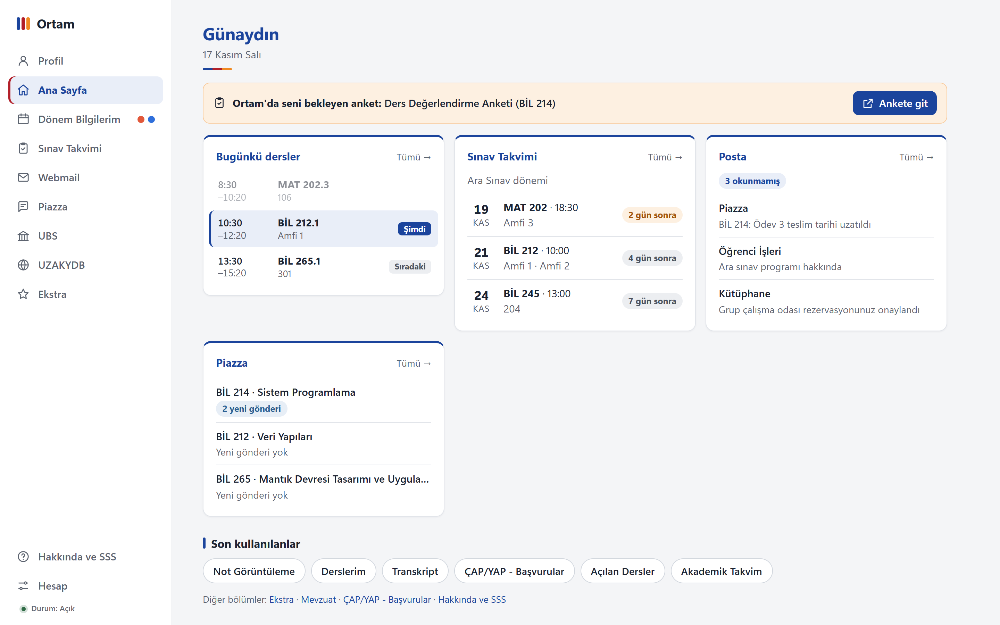
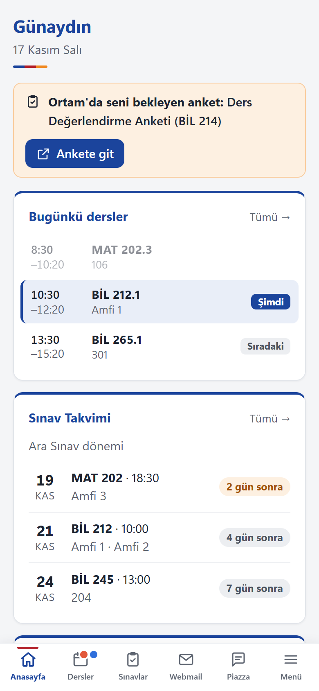
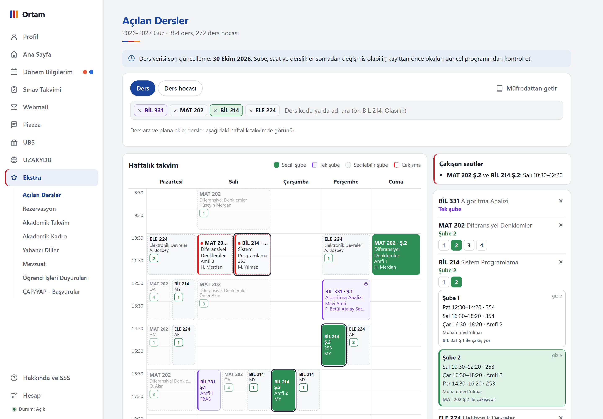

# Ortam Sade · ETÜ Cep

TOBB ETÜ'nün okul sitelerini (**Ortam, UBS, Uzak, UZAKYDB, Webmail, Piazza**) tek, sade bir uygulamada toplar.
Bilgisayarda **Ortam Sade** (Windows), telefonda **ETÜ Cep** (Android) adıyla çalışır. Ücretsiz ve açık kaynaklı bir öğrenci projesidir.

**[Tanıtım ve indirme sayfası](https://soft-coder-183.github.io/ortam-sade/) · [İndir: Windows](#indir) · [İndir: Android](#indir) · [Ekran görüntüleri](#ekran-görüntüleri)**

> **Resmî değildir.** TOBB ETÜ tarafından geliştirilmemiş, onaylanmamış ve desteklenmemektedir. Ders kaydı, not, sınav yeri,
> başvuru gibi resmî konularda her zaman okulun kendi sistemleri esastır.

## Güvenlik: şifren nerede, kod ne yapıyor, dosyaya nasıl güvenirsin

1. **Şifren yalnızca kendi cihazında durur.** Uygulamanın bir sunucusu yoktur; arada başka bir bilgisayar yoktur. Uygulama
   okulun sitelerine doğrudan, senin cihazından bağlanır. Şifren yalnızca okulun kendi giriş sayfalarına (ve Piazza girişine) gider.
   "Beni hatırla" seçiliyse cihazında şifreli olarak saklanır: Windows'ta Windows hesabına bağlı DPAPI kasasında, Android'de
   Android Keystore anahtarıyla. Oturum çerezleri ve okuldan alınan veriler de AES-256 ile şifreli tutulur.
2. **Kodun tamamı burada ve okunabilir.** Uygulamanın yaptığı her şey bu depodaki koddadır; gizli kod yoktur, uygulama başka yerden kod indirip çalıştırmaz (güncelleme de yalnızca senin onayınla, bu depodan gelir).
   Kendin okuyabilir ya da bir yapay zekâ asistanına inceletebilirsin: yeşil **Code → Download ZIP** ile depoyu indir, asistana
   ver ve örneğin şunu sor: *"Bu uygulama şifremi ya da okul verilerimi okulun siteleri dışında bir yere gönderiyor mu?"*
   Uygulamanın bağlandığı adresler yalnızca şunlardır: okulun siteleri (`*.etu.edu.tr`), `piazza.com`, mevzuat kaynakları
   (`mevzuat.gov.tr`, Resmî Gazete) ve yeni sürüm denetimi için `github.com`.
   - Şifrenin saklandığı yer: [`server/credentials.mjs`](server/credentials.mjs), [`server/vault.mjs`](server/vault.mjs)
   - Şifrenin kullanıldığı tek yer (sitelere giriş): [`server/autologin.mjs`](server/autologin.mjs)
3. **İndirdiğin exe, zip ve apk tam olarak bu koddan üretilir.** Dosyaları kimse elle yüklemez: her sürümü GitHub'ın kendi
   sunucusu bu depodaki koddan derler ([iş akışı](.github/workflows/surum.yml)) ve dosyaya GitHub'ın imzaladığı bir
   **kaynak kanıtı** (build provenance) ekler. Kanıt, dosyanın hangi commit'ten, hangi iş akışıyla üretildiğini gösterir; dosya
   sonradan bir bayt bile değiştirilse doğrulama başarısız olur.
   - **Tarayıcıdan bak:** [Kanıtlar sayfası](https://github.com/Soft-Coder-183/ortam-sade/attestations) her dosyanın kanıtını,
     [Actions sayfası](https://github.com/Soft-Coder-183/ortam-sade/actions/workflows/surum.yml) her derlemenin kaydını gösterir.
   - **Kendin doğrula** ([GitHub CLI](https://cli.github.com/) ile, dosyanın indiği klasörde):
     ```
     gh attestation verify OrtamSade-kurulum.exe --repo Soft-Coder-183/ortam-sade
     gh attestation verify OrtamSade-win-x64.zip --repo Soft-Coder-183/ortam-sade
     gh attestation verify EtuCep.apk --repo Soft-Coder-183/ortam-sade
     ```
     "Verification succeeded" yazıyorsa dosya bu depodaki koddan çıkmıştır ve arada değiştirilmemiştir.

Ayrıca: uygulama CAPTCHA ve güvenlik doğrulamalarını aşmaz (o kodu sen yazarsın); okula bir şey gönderen işlemler (form,
e-posta gönderme/silme) yalnızca senin tıklamanla ya da açtığın bir ayarla yapılır; hiçbir şey sormadan güncellenmez.

## Öne çıkanlar

1. **Bildirimler.** Piazza'ya yeni gönderi, **Uzak'a yeni dosya, ödev ya da duyuru** eklenince bildirim gelir; Uzak'ın kendi
   bildirim sistemi yok, bunu yalnızca bu uygulama yapar. Bildirime basınca içeriğin kendisi açılır. Sınavından bir gün önce,
   ders kaydı, ekle-sil, dersten vazgeçme ve ÇAP/YAP başvurusu gibi tarihler yaklaşınca da hatırlatır. İstersen okul adresine
   kısa bir özet e-posta da gelir.
2. **Bütün siteler bir arada, tek girişle.** E-posta ve şifreni bir kez girersin; Ortam, UBS, Uzak, UZAKYDB, Webmail ve Piazza
   aynı menüde, her biri tek tıkla açılır. Bir dersin Ortam, Uzak ve Piazza içeriği tek sayfada durur.
3. **Açılan Dersler ve haftalık plan.** Bu dönem açılan dersleri ya da hocayı ara, plana ekle; şubeler haftalık takvimde görünür,
   çakışmalar işaretlenir, "Çakışmayan programları bul" en iyi beş programı çıkarır.
4. **Sade ve düzenli arayüz.** Okul sitelerindeki gereksiz menüler, tekrarlar ve kalabalık ayıklandı; her şey aynı düzende,
   açık ve koyu temayla, telefonda da düzgün görünür. Sınav takvimi tek satır tek sınav; Webmail'de okulun gereksiz e-postaları
   (Piazza bildirimleri, Yabancı Diller giriş uyarıları) kendiliğinden temizlenir.

Ayrıca: Piazza kaynaklarını bölüm bölüm tek tuşla indirme (klasöre, zip olarak ya da içindeki zipler açılmış),
ortalama ve ders planı hesabı, yönetmelikler arasında arama ve maddeye dayalı hızlı yanıtlar, kütüphane odası
rezervasyonu, akademik takvim ve kadro.

## Ekran görüntüleri

Görüntülerdeki öğrenci ve veriler uydurmadır.

| Windows · Ana Sayfa | Android (ETÜ Cep) · Ana Sayfa |
|---|---|
|  |  |

**Açılan Dersler ve haftalık plan**



## İndir

Bağlantılar her zaman en son sürümü indirir. Hangisini seçeceğini bilmiyorsan bilgisayarda birincisini, telefonda üçüncüsünü al.

| | Dosya | Kimin için |
|---|---|---|
| **Windows (önerilen)** | **[OrtamSade-kurulum.exe](https://github.com/Soft-Coder-183/ortam-sade/releases/latest/download/OrtamSade-kurulum.exe)** | Çoğu kişi. Çift tıkla, kurulsun. Yönetici izni istemez; Başlat menüsüne kısayol koyar, bilgisayar açılınca bildirimler için arka planda başlar (istersen kurulumda kaldırırsın). |
| **Windows (kurulumsuz)** | **[OrtamSade-win-x64.zip](https://github.com/Soft-Coder-183/ortam-sade/releases/latest/download/OrtamSade-win-x64.zip)** | Bilgisayarına bir şey kurmak istemeyenler. Zip'i bir klasöre çıkar, içindeki `OrtamSade.exe`'ye çift tıkla. Silmek için klasörü silmen yeter. |
| **Android (ETÜ Cep)** | **[EtuCep.apk](https://github.com/Soft-Coder-183/ortam-sade/releases/latest/download/EtuCep.apk)** | Telefon (Android 10 ve üzeri). Telefonda bu bağlantıya bas, inen dosyayı aç, kur. |

Bütün sürümler ve sürüm notları: [Sürümler sayfası](https://github.com/Soft-Coder-183/ortam-sade/releases).

**Uyarı çıkarsa:**
- **Windows "Windows bilgisayarınızı korudu" derse:** *Ek bilgi → Yine de çalıştır.* Dosya imzasızdır: Windows'un tanıdığı bir
  kod imzalama sertifikası yıllık ücretlidir. Dosyanın bu koddan çıktığını yukarıdaki kanıtla doğrulayabilirsin.
- **Android "bilinmeyen kaynak" izni isterse:** tarayıcına bu dosya için izin ver. **Play Protect** uygulamayı taramak isterse (güncellemede de)
  "Taramadan yükle"ye, uyarırsa "Yine de yükle"ye bas;
  seçenek çıkmazsa Play Store → Play Protect → Ayarlar'dan taramayı kurulum süresince kapatabilirsin.
- Windows'ta Google Chrome ya da Microsoft Edge kurulu olmalıdır (Ortam girişi ve PDF için). Node.js kurmana gerek yok.

## Neden böyle?

- **Neden bir web sitesi değil?** Bir web sitesi olsaydı şifren o sitenin sunucusundan geçerdi ve o sunucuda hangi kodun
  çalıştığını göremezdin. Uygulama senin cihazında çalıştığı için şifren cihazından çıkıp başka bir yere gitmez ve çalışan kod
  tam olarak bu depodaki koddur.
- **Neden Play Store değil, GitHub?** Play Store'daki bir uygulamanın hangi koddan üretildiğini kullanıcı kendisi denetleyemez.
  Burada her dosyanın bu açık koddan üretildiği imzalı kanıtla, herkes tarafından doğrulanabilir. Güveni bir mağazanın onayına
  değil, okunabilen koda ve doğrulanabilen dosyaya dayandırmak istedik.
- **Neden kurulum dosyası (exe)?** Uygulama Node.js ile yazıldı; komut satırı kullanmayı gerektirmesin, tek tıkla kurulsun diye.
- **Neden ayrıca zip?** Bir şey kurmak istemeyen, ortak bir bilgisayar kullanan ya da kurulumun ne yaptığını görmek isteyenler
  için: zip açılıp çalıştırılır, hiçbir yere bir şey yazmaz, klasör silinince biter.
- **Neden ayrıca APK?** Bildirimler telefonda daha çok işe yarıyor. Telefon uygulaması aynı kodu kullanır, ayrı bir sunucusu yoktur.

## Güncelleme

Yeni sürüm çıkınca uygulama sorar. **Görünmez güncelleme yoktur:** "Güncelle"ye basmadan hiçbir şey indirilmez. Basınca dosya
yalnızca bu deponun Sürümler sayfasından indirilir ve GitHub'ın yayımladığı **SHA-256 özetiyle doğrulanır**; uyuşmazsa kurulmaz.
Şifren, oturumların ve ayarların korunur. Telefonda kurulumu Android'in kendi onay ekranı yapar.
Sürümü ve "Güncellemeleri denetle" düğmesini **Hakkında ve SSS → Hakkımızda** sayfasında bulabilirsin.

## Gizlilik ayrıntıları

- Windows'ta uygulama yalnızca `127.0.0.1`'den erişilebilir; ağdaki başka cihazlar bağlanamaz.
- Şifren yalnızca "Beni hatırla" seçiliyse saklanır. Şifreleme anahtarı Windows hesabına (DPAPI) ya da Android Keystore'a
  bağlıdır: dosyalar kopyalansa da başka bir hesapta ya da cihazda açılamaz. (Aynı Windows hesabında çalışan başka bir
  programa karşı koruma değildir.)
- **Oturumlar senin kontrolünde** (Hesap > Güvenlik ve Oturumlar): oturumları açık tutmayı ve kendiliğinden yeniden girmeyi
  kapatabilir, her sitede ya da hepsinde birden oturumu kapatabilirsin. Arka planda ne yapıldığı ve ne sıklıkta yapıldığı orada yazar.
- **İsteğe bağlı PIN:** açıkken uygulama her açılışta ve hareketsiz kalınca kilitlenir. PIN yalnızca tuzlu özet (scrypt) olarak saklanır.
- Bildirim e-postaları senin okul adresinden yine sana gönderilir. Geri Bildirim formu yalnızca "Gönder"e basarsan, senin okul
  postandan geliştiriciye gider.

## Okulun sunucularına yük

Yalnızca açtığın ekranın sayfası okuldan istenir ve kısa süre önbellekte tutulur. Arka planda yapılanlar:

| İş | Sıklık |
|---|---|
| Ortam oturumunu açık tutma | 10 dakikada bir |
| UBS oturumunu açık tutma | 15 dakikada bir |
| Webmail / Uzak / UZAKYDB / Piazza oturumu | 2,5–4 saatte bir (UZAKYDB'ye yalnızca ekranını açınca girilir) |
| Piazza yeni gönderi kontrolü | 10 dakikada bir (telefonda yaklaşık 30 dakikada bir) |
| Uzak yeni içerik kontrolü | saatte bir (telefonda yarım saatte bir) |
| Akademik Takvim ve sınav hatırlatmaları | 3 saatte bir |
| Yeni sürüm denetimi (GitHub) | 6 saatte bir |
| Mevzuat metinleri | yalnızca Mevzuat açılınca; her belge haftada en fazla bir kez |

O aralıkta siteye zaten bir istek gittiyse oturum kontrolü atlanır. Windows'ta uygulama kapalıyken hiçbir istek yapılmaz.

- **Kendini tanıtır:** istekler tarayıcı kimliğinin sonunda uygulamanın adını, sürümünü ve bu deponun adresini taşır
  (`OrtamSade/1.8.4 (+https://github.com/Soft-Coder-183/ortam-sade)`, telefonda `EtuCep/…`). Okulun sistem yöneticisi isteklerin
  nereden geldiğini görebilir.
- **Hata freni:** bir site üst üste hata verirse (bağlantı hatası, 5xx, 429) uygulama o siteye bir süre istek göndermez; süre her
  hatada ikiye katlanır (15 sn'den 30 dk'ya kadar), ilk başarılı yanıtta sıfırlanır. Ayrıca bir siteye dakikada 120'den çok istek
  gönderilmez; bir hata döngüye girse de sunucu sürekli istek almaz ([`server/istemci.mjs`](server/istemci.mjs)).

## Geliştirme

```bash
npm install
npm run dev        # sunucu dosyaları değişince kendini yeniden başlatır
npm start          # normal çalıştırma
```

Kurulum dosyası, zip ve Android APK'yı tek komutla üretmek için: [BUILD.md](BUILD.md) (`build.ps1`).
Yapı: `server/` (her site için bir modül: `ortam`, `ubs`, `moodle` (Uzak/UZAKYDB), `webmail`, `piazza`, `mevzuat` …),
`public/` (tek sayfalık arayüz), `mobile/` (Android). Sunucu her ekran için okulun tek sayfasını açıp sadeleştirilmiş JSON döndürür.

## Code signing policy

*(English, for code signing reviewers.)* Windows releases (`OrtamSade-kurulum.exe`, `OrtamSade.exe` in `OrtamSade-win-x64.zip`)
are built only by the [GitHub Actions release workflow](.github/workflows/surum.yml) from this repository; every release file
carries a GitHub build provenance attestation. **Signing status:** an application for free code signing by
[SignPath Foundation](https://signpath.org) is pending; until it is approved, release files are unsigned.

- **Committers and reviewers:** Eren Akyurt ([@Soft-Coder-183](https://github.com/Soft-Coder-183)). Changes from anyone else
  (pull requests) are reviewed before merging.
- **Approvers:** Eren Akyurt ([@Soft-Coder-183](https://github.com/Soft-Coder-183)). Every release is approved manually.

### Privacy policy

The program runs entirely on the user's device; it has no server of its own and collects no telemetry. It connects only to:

- **The school's sites** (`*.etu.edu.tr`) and **piazza.com**, with the user's own account, after the user signs in. The password
  is sent only to these sites' login pages and is stored, if the user chooses "remember me", encrypted on the device
  (Windows DPAPI / Android Keystore).
- **Legislation sources** (`mevzuat.gov.tr`, Resmî Gazete), only when the user opens the legislation screen.
- **GitHub** (`api.github.com`, `github.com`), to check for a new release every 6 hours. No personal data is sent. Updates are
  downloaded and installed only when the user clicks "Update".
- **The user's own school e-mail account**: optional notification summaries are sent from the user's address to the same address
  (can be turned off in settings); the feedback form sends a message to the developer only when the user clicks "Send".

System changes, all announced and reversible: the installer installs per user (no administrator rights), adds Start menu and
optional desktop shortcuts, an optional start-at-login entry (a checkbox in the installer) and registers the `ortamsade:` link
type under the current user. The uninstaller removes all of these and asks before deleting the user's saved data. The portable zip version installs
nothing; it only registers the `ortamsade:` link type for the current user when first started. Downloaded files are written only
when the user asks: to the user's Downloads folder (a bulk Piazza download "to a folder" creates a new subfolder there and opens it
in Explorer).

## Lisans

[MIT](LICENSE). Pakette Node.js çalışma ortamı ve bağımlılıklar (cheerio, pdf.js, playwright-core) kendi lisanslarıyla gelir.
